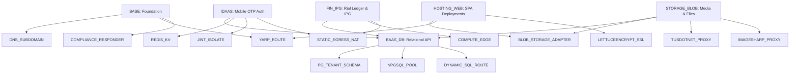

# LocalMe

<div align="center">

**Unified Backend-as-a-Service (BaaS) & Edge Platform-as-a-Service (PaaS)**  
*Pure .NET 10 Stack • PostgreSQL 18.1 • Redis 7/8*

[](https://github.com/LocalMeProject/localme/actions/workflows/ci.yml)
[](LICENSE)
[](https://dotnet.microsoft.com/)
[](https://nx.dev)

</div>

---

## 1. Executive Summary

**LocalMe** eliminates backend and infrastructure engineering for web and mobile product teams operating in the Iran-native ecosystem and globally. A developer creates a project, receives an instant pre-configured static subdomain (`{slug}.localme.ir`) or binds a custom domain, deploys an immutable frontend bundle or connects mobile SDKs, and enables exact backend capabilities on demand.

An automated **Directed Acyclic Graph (DAG) Dependency Matrix Engine** provisions, wires, isolates, and scales the underlying infrastructure primitives inside a single consolidated **.NET 10 process group** (backed by PostgreSQL 18.1 and Redis 7/8).

### 1.1 Pure .NET 10 Consolidation

All external runtime binaries (Envoy, NATS, Dragonfly, ClickHouse, EMQX, PostgREST, PgBouncer, libvips, CoreDNS) are replaced with native .NET 10 and managed engines:

| Subsystem | Consolidated Replacement |
|---|---|
| Edge Proxy & SSL | **YARP (`Yarp.ReverseProxy`)** + **Kestrel Dynamic SNI** + **LettuceEncrypt** (in-process ACME) |
| Relational Data Plane | **`NpgsqlDataSource` multiplexing** + custom zero-allocation dynamic SQL pipeline |
| Sandboxed Compute | **`Jint 4.x`** (managed C# JS engine, 16MB memory governor, 5s timeouts) |
| Event Streaming & Queues | **Redis Streams (`XADD` / `XREADGROUP`)** via `StackExchange.Redis` |
| Real-Time PubSub & Push | **ASP.NET Core SignalR** (Redis backplane) + **`MQTTnet.AspNetCore`** (embedded domestic MQTT broker) |
| Storage & Resumable Upload | **`tusdotnet`** (TUS v1.0.0) + **`SixLabors.ImageSharp.Web`** + **`IBlobStorageAdapter`** (Runflare, Arvan, MinIO, LocalDisk) |
| Authoritative DNS | **`ARSoft.Tools.Net`** authoritative service with Redis pub/sub invalidation |

---

## 2. Monorepo Architecture & Projects

The repository is governed as an enterprise polyglot monorepo orchestrated by **Nx**:

```text
localme/
├── apps/
│   ├── server/           # ASP.NET Core 10 multi-role host (edge, control, data, worker)
│   ├── cli/              # Developer command-line interface (localme deploy/init/status)
│   └── web-console/      # Developer portal (React 19, TypeScript, Vite, Tailwind, Apple Design)
├── libs/
│   ├── core-domain/      # Pure DDD core, DAG matrix engine, IRR currency math (Profile A)
│   ├── data-plane/       # In-process middleware, blob adapters, Jint runner, compliance (Profile A)
│   ├── infrastructure/   # PostgreSQL 18.1 schemas, Redis Lua scripts, ARSoft DNS (Profile A)
│   ├── contracts/        # Shared OpenAPI 3.1 specifications & schemas (Profile D)
│   └── client-sdk/       # Official TypeScript client SDK (@localme/sdk) (Profile D)
├── tests/
│   ├── LocalMe.Core.Tests/         # Domain invariant and DAG engine unit tests
│   └── LocalMe.Integration.Tests/  # Adapter and persistence integration harness
├── docs/
│   ├── adr/              # Architecture Decision Records (ADR-0001 through ADR-0004)
│   ├── nc/               # NEED_CLARIFICATION tracking registry
│   └── SSOT.md           # Master Source of Truth Product Specification
└── scripts/              # Mechanical governance validation tools (verify-nx-targets, etc.)
```

---

## 3. Capability-to-Primitive DAG Matrix

Developers toggle user-facing capabilities; the DAG engine resolves dependencies and manages atomic reference counts on internal primitives:



---

## 4. Iran Regulatory & Financial Sovereign Layer

1. **Headless e-Namad / Samandehi Responder**: Automatic plain-text token response at `/enamad.txt` and `/samandehi.txt`, plus streaming edge injection of `<meta name="enamad" content="..." />` into hosted SPA bundles.
2. **Static Egress NAT Gateway Pool**: Whitelisted domestic Iranian static IPs for all outbound banking PSP calls (Zarinpal, SEP, Behpardakht, Parsian) and SMS gateways (MeliPayamak, Kavenegar).
3. **Strict Iranian Rial (`IRR`) Double-Entry Ledger**: Stored in 64-bit integer (`BIGINT`) amounts. Toman is used strictly as a presentation projection (`ToTomanString()`).
4. **Domestic Intranet Push Fallback**: Embedded MQTT-over-WebSocket broker (`MQTTnet`) on port 443 ensuring real-time notification delivery even during international internet disruptions.

---

## 5. Getting Started & Verification

### Prerequisites
- **.NET 10 SDK** (v10.0.100+)
- **Node.js** (v22+) and **pnpm** (v12+)
- **Python 3.12+** (for mechanical governance validation)

### Build & Run
```bash
# 1. Build entire .NET 10 solution
dotnet build LocalMe.sln -c Release

# 2. Run domain unit and integration tests
dotnet test LocalMe.sln -c Release

# 3. Test LocalMe CLI
dotnet run --project apps/cli/src/LocalMe.Cli.csproj -- status
dotnet run --project apps/cli/src/LocalMe.Cli.csproj -- matrix

# 4. Run enterprise mechanical governance checks
pnpm run gates
```

---

## 6. Enterprise Governance & CI Gates

The repository strictly enforces enterprise mechanical compliance via GitHub Actions:
- **`verify-nx-targets.py`**: Ensures all projects implement `lint`, `test`, `build`, and `audit`.
- **`verify-agent-manifests.py`**: Validates `AGENT.md` profile contracts and prevents illegal Tier 1 overrides.
- **`check-nc-items.py`**: Blocks PR merges if open `NEED_CLARIFICATION` items are $\ge 14$ days old.
- **`validate-change-surface.py`**: Enforces pre-implementation blast radius declarations (`CHANGE_SURFACE.md`).

---

## 7. License

MIT License. Copyright © 2026 LocalMe Project.
