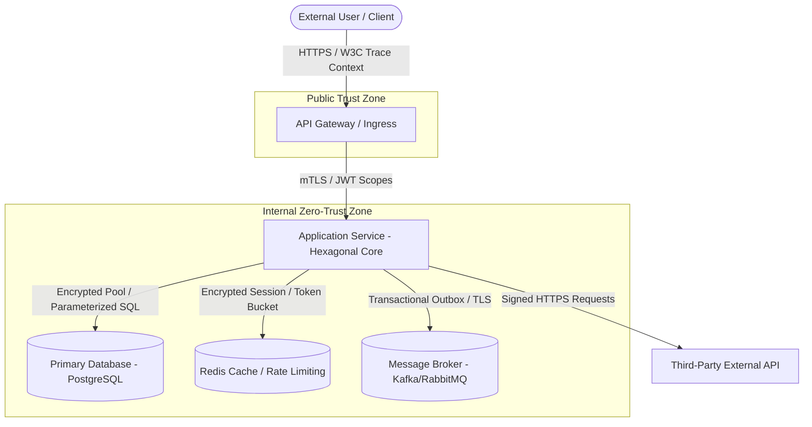

# Threat Model: [SYSTEM_NAME]

**Document Version**: `1.0.0`  
**Date**: `{{YYYY-MM-DD}}`  
**Authors**: `{{TEAM_NAMES}}`  
**Security Reviewer**: `{{SECURITY_REVIEWER}}`  
**Status**: `Draft` / `Under Review` / `Approved`

---

## 1. System Overview & Architecture Diagram
*Describe the high-level application architecture, entry points, trust boundaries, and primary assets.*

### 1.1. Data Flow Diagram (DFD)

### 1.2. Trust Boundaries
1. **TB-01 (Public Internet $\to$ API Gateway)**: Untrusted boundary. Requires strict TLS termination, WAF filtering, DDoS mitigation, and rate limiting.
2. **TB-02 (API Gateway $\to$ Internal Service)**: Internal boundary. Enforces mTLS, authenticated JWT token validation, and scope verification.
3. **TB-03 (Service $\to$ Persistence Stores)**: Data persistence boundary. Dedicated service credentials with least privilege, encrypted in transit (TLS) and at rest (KMS).

---

## 2. Asset Classification
- **Customer Personal Identifiable Information (PII)**: Emails, phone numbers, legal names (`Tier 2 - Confidential`).
- **Authentication Credentials**: Password hashes, JWT signing keys, OAuth secrets (`Tier 1 - Restricted`).
- **Financial & Transaction Data**: Ledger records, billing transactions (`Tier 1 - Restricted`).
- **System Observability & Audit Logs**: Structured logs, metrics, trace headers (`Tier 3 - Internal`).

---

## 3. STRIDE Threat Analysis

| Threat Category | Threat Description | Attack Vector | Severity | Mitigation & Mechanical Controls | Status |
|---|---|---|---|---|---|
| **S**poofing | Attacker impersonates authorized user via stolen token | Replay or forged JWT | High | Asymmetric RS256/EdDSA JWT validation; short-lived access tokens (15m) + refresh token rotation. | Implemented |
| **T**ampering | SQL or parameter manipulation altering persistent records | Unsanitized input in query | Critical | Parameterized queries enforced via Check 5.1 & AST checks. Zero query string concatenation. | Implemented |
| **R**epudiation | Malicious administrator deletes or modifies financial transaction | Direct database update | High | Append-only immutable audit logging table (Check 4.8) with cryptographic hash chaining and write-only grants. | Implemented |
| **I**nformation Disclosure | Sensitive customer PII leaked via application logs or trace metadata | Exception stack traces | High | Automated PII log scrubber (Check 6.5) masking emails, tokens, and cards. Metric cardinality bounding (Check 6.8). | Implemented |
| **D**enial of Service | Malicious actor exhausts connection pool or memory via burst requests | Request flooding | High | Public ingress rate limiting (Check 5.8) with token bucket; consumer backpressure (Check 3.7) and resource limits (Check 1.6). | Implemented |
| **E**levation of Privilege | Tenant A accesses Tenant B's data by manipulating ID parameters (IDOR) | Parameter tampering | Critical | Mandatory Multi-Tenancy Scoping (Check 5.6) enforced in repository adapter via tenant context filter and RLS. | Implemented |

---

## 4. Abuse Case Scenarios

### Abuse Case 1: Credential Stuffing & Brute Force Ingress
- **Actor**: External botnet.
- **Goal**: Compromise customer accounts by cycling stolen password lists.
- **Detection**: Rate-limit triggers in `ep_security` / WAF alert on spike in 401 Unauthorized responses.
- **Enforcement**: Token bucket rate limiter restricts login attempts to $\le 5$ per IP/username per 5-minute window; automatic IP temporary ban.

### Abuse Case 2: Outbox Worker Interception / Duplicate Payment Trigger
- **Actor**: Compromised internal service or rogue message replay.
- **Goal**: Replay financial capture messages to trigger duplicate credit card charges.
- **Detection**: Idempotency key conflict counter in metrics.
- **Enforcement**: Idempotent message consumer (Check 4.3) with atomic deduplication table keyed by `(idempotency_key, action)`.

---

## 5. Residual Risk & Review Sign-Off
- **Residual Risk Rating**: LOW. All critical and high threats are mechanically mitigated via deterministic architectural checks.
- **Review Cadence**: Reviewed annually or upon any major architectural change requiring a Tier 2 ADR.
